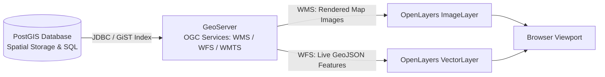
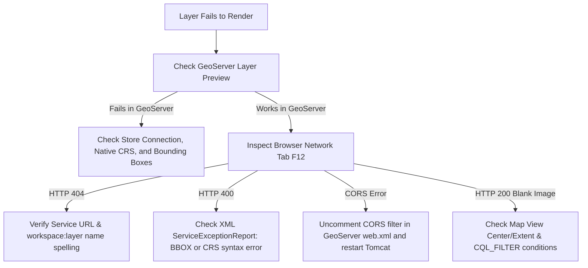

# Module 3 - GeoServer & PostGIS Enterprise Integration

Welcome to Module 3! In this module, we transition from standalone static files to the industry-standard enterprise Web GIS architecture: **PostGIS** as the spatial database engine, **GeoServer** as the publishing and middleware server, and **OpenLayers** as the high-performance client mapping library.



---

## 1. The Enterprise Web GIS Architecture

### 1.1 The 3-Tier Enterprise Pipeline
In production spatial systems, data flows through three distinct operational tiers:

```text
               ENTERPRISE 3-TIER ARCHITECTURE
Storage Tier:       PostgreSQL + PostGIS
                    (Raw Coordinates, GiST Spatial Indexes, Spatial SQL)
                                   ↓ (JDBC Connection Pool)
Middleware Tier:    GeoServer
                    (GeoTools Engine, SLD Cartography, OGC Services: WMS/WFS/WMTS)
                                   ↓ (HTTP / HTTPS Standards)
Client Tier:        OpenLayers
                    (HTML5 Canvas/WebGL Engine, Layer & Interaction Management)
                                   ↓
Presentation Tier:  Web Browser Viewport
```

- **Storage & Processing Tier (PostGIS):** Stores millions of coordinate geometries, enforces topological rules, performs spatial joins, and filters records using R-Tree spatial indexes.
- **Middleware & Service Tier (GeoServer):** Reads spatial tables, validates coordinate systems, calculates extents, styles data on the server via SLD, and exposes standardized OGC web service endpoints.
- **Client Tier (OpenLayers):** Requests server-rendered map images (WMS) or raw vector geometries (WFS), handles smooth pan and zoom navigation, and provides interactive user tools.

### 1.2 Client-Side vs. Server-Side Spatial Processing

| Processing Location | Strengths | Best Used For |
|---|---|---|
| **Server-Side (PostGIS)** | • Queries millions of records in milliseconds<br>• Leverages GiST spatial indexes<br>• Executes complex spatial joins and heavy geoprocessing | • Spatial containment (`ST_Within`)<br>• Proximity buffer analysis (`ST_DWithin`)<br>• Large-scale spatial aggregation |
| **Client-Side (OpenLayers)** | • Zero network latency once loaded<br>• Smooth 60 FPS animations and hover states<br>• Instant user selection and measurement | • Feature click popups & tooltips<br>• Highlighting geometries under the mouse<br>• Client-side dynamic styling and drawing |

> **Key Architectural Rule:** Always filter, clip, and aggregate as close to the database as possible. Never download 500,000 features over the network into OpenLayers when the user only needs to view 50.

---

## 2. PostGIS: The Enterprise Spatial Database

### 2.1 PostgreSQL vs. PostGIS
- **PostgreSQL:** An open-source Object-Relational Database Management System (ORDBMS) offering ACID transactions, sophisticated concurrency, and enterprise reliability.
- **PostGIS:** The spatial database extension for PostgreSQL that adheres to the **OGC Simple Features for SQL (SFS)** specification, adding:
  - Native spatial data types (`geometry`, `geography`, `raster`).
  - Over 1,000 spatial functions for measurement, relationships, and processing.
  - R-Tree spatial indexing via **GiST (Generalized Search Tree)**.
  - Spatial reference system metadata (`spatial_ref_sys`).

### 2.2 PostGIS Spatial Data Types: `geometry` vs. `geography`

```text
PostGIS Spatial Data Types
 ├── geometry   → Planar / Cartesian (Euclidean math, any projection: EPSG:3857, UTM, etc.)
 └── geography  → Geodetic / Spherical (Great Circle math, strictly WGS 84 EPSG:4326, meters)
```

| Feature | `geometry` | `geography` |
|---|---|---|
| **Coordinate Space** | Flat Cartesian plane | Curved sphere / ellipsoid |
| **Supported Projections** | Any CRS (EPSG:4326, EPSG:3857, UTM, State Plane) | Strictly WGS 84 (`EPSG:4326`) |
| **Measurement Units** | Matches CRS units (meters for 3857/UTM; degrees for 4326) | Always in **meters** automatically |
| **Performance** | Extremely fast; full spatial function catalog | Slightly slower computation; focused function subset |
| **Typical Use** | City/regional maps, CAD/engineering, Web GIS | Global flight paths, international maritime boundaries |

### 2.3 Core OGC Geometry Types (WKT)
PostGIS represents shapes using Well-Known Text (WKT):
- **`POINT(73.8567 18.5204)`**: Single coordinate point.
- **`LINESTRING(73.85 18.52, 73.86 18.53, 73.87 18.55)`**: Connected line segments.
- **`POLYGON((73.85 18.52, 73.86 18.52, 73.86 18.53, 73.85 18.53, 73.85 18.52))`**: Closed polygon boundary.
- **Multi-Geometries:** `MULTIPOINT`, `MULTILINESTRING`, `MULTIPOLYGON`, and heterogeneous `GEOMETRYCOLLECTION`.

### 2.4 SRID and Coordinate Reference Systems
An **SRID (Spatial Reference System Identifier)** identifies a coordinate reference system in the EPSG registry:
- **`EPSG:4326` (WGS 84):** Unprojected geographic coordinates in angular degrees (Longitude: -180 to +180, Latitude: -90 to +90). Used by GPS and GeoJSON.
- **`EPSG:3857` (Web Mercator):** Projected planar coordinates in meters. Used by Google Maps, OpenStreetMap, and OpenLayers default views.
- **Projected Grids (e.g., UTM Zone 43N - `EPSG:32643`):** Conformal projections designed for meter-accurate distance and area measurements within a defined zone.

```sql
-- Convert WGS 84 degrees into Web Mercator planar meters:
SELECT id, ST_Transform(geom, 3857) AS geom_3857
FROM buildings;

-- Set SRID metadata if missing (does NOT change coordinate values):
SELECT ST_SetSRID(ST_Point(73.8567, 18.5204), 4326);
```

### 2.5 Essential PostGIS Spatial Functions

| Function | Description | Return Type |
|---|---|---|
| `ST_Area(geom)` | Computes the area of a polygon in CRS units | `double precision` |
| `ST_Length(geom)` | Computes line length in CRS units | `double precision` |
| `ST_Centroid(geom)` | Computes the geometric center point | `geometry (Point)` |
| `ST_Buffer(geom, radius)` | Creates a boundary buffer of `radius` units | `geometry (Polygon)` |
| `ST_Intersects(geomA, geomB)` | Returns true if geometries share any space | `boolean` |
| `ST_Within(geomA, geomB)` | Returns true if A is completely inside B | `boolean` |
| `ST_Contains(geomA, geomB)` | Returns true if A completely encloses B | `boolean` |
| `ST_DWithin(geomA, geomB, dist)`| Returns true if geometries are within `dist` units (Index-accelerated) | `boolean` |
| `ST_Distance(geomA, geomB)` | Returns minimum 2D distance between geometries | `double precision` |

### 2.6 Spatial Indexing with GiST (R-Trees)
Spatial shapes have no natural 1D order. Finding which polygons intersect without an index requires comparing every single vertex against all records. PostGIS resolves this using **GiST (Generalized Search Tree)** indexes based on **R-Trees**, indexing the 2D **Bounding Box (Envelope)** of each geometry.

```sql
CREATE INDEX buildings_geom_idx ON buildings USING GIST (geom);
```

#### Two-Stage Query Processing
When executing a spatial query like `ST_Intersects(buildings.geom, parcel.geom)`:
1. **Stage 1 (Index Filter):** PostGIS uses the GiST index to compare bounding boxes (`&&`). This instantly eliminates 99.9% of geometries that do not touch.
2. **Stage 2 (Exact Test):** PostGIS runs exact point-in-polygon vertex math only on the surviving candidate records.

---

## 3. GeoServer: Architecture & Publishing Data

### 3.1 What is GeoServer?
**GeoServer** is an open-source Java application that shares and edits geospatial data according to OGC standards. Built on top of the **GeoTools** spatial engine, GeoServer connects to spatial databases, renders map graphics, and publishes services.

### 3.2 GeoServer Data Hierarchy
GeoServer organizes spatial data into a four-level administrative structure:

```text
Workspace (Logical department container & XML namespace)
   └── Store (Physical connection to PostGIS database or directory)
        └── Layer / FeatureType (Individual spatial table or file)
             └── Style (SLD cartographic symbology rules)
```

- **Workspace:** Groups related stores and layers together (e.g., `training`). Layer qualified names take the form `workspace:layer_name` (e.g., `training:roads`, `training:buildings`).
- **Store:** Connection configuration to the data source (PostGIS database, Directory of Shapefiles, GeoPackage, or GeoTIFF).
- **Layer / Resource:** The published dataset with verified CRS, bounding boxes, and assigned style.
- **Layer Group:** A combined endpoint that packages multiple layers together in a single request.

### 3.3 Connecting PostGIS to GeoServer
1. In PostgreSQL, ensure the extension is active:
   ```sql
   CREATE EXTENSION IF NOT EXISTS postgis;
   ```
2. In GeoServer Admin: **Stores → Add new Store → PostGIS (Vector Data DataStore)**.
3. Enter connection parameters: Host (`localhost`), Port (`5432`), Database (`gis_training`), Schema (`public`), Username, and Password.
4. Save the store.

### 3.4 Publishing a Layer (The 8-Step Workflow)

```text
1. Create Workspace → 2. Add Store → 3. Select Table → 4. Publish Layer
        ↓
5. Verify CRS → 6. Calculate Bounding Boxes → 7. Configure Style → 8. Layer Preview
```

- **Verify CRS:** Ensure **Native CRS** is detected (e.g., `EPSG:4326`). If unknown, set **Declared CRS** and choose *Force Declared*.
- **Compute Bounding Boxes:** Click **Compute from data** (Native Bounding Box) and **Compute from native bounds** (Lat/Lon Bounding Box). *If bounding boxes are missing or zero, OpenLayers will not display the layer.*
- **Assign Style:** Select a default SLD style under the **Publishing** tab.
- **Preview:** Verify the layer in GeoServer's **Layer Preview** list.

### 3.5 GeoServer SQL Views
GeoServer allows publishing raw PostGIS SQL queries as independent map layers.
- **Static SQL View:** Pre-filters records or runs spatial operations on the database before GeoServer draws them (e.g. querying Natural Earth `populated_places`):
  ```sql
  SELECT id, name, adm0name, pop_max, ST_Buffer(geom, 0.5) AS geom
  FROM populated_places
  WHERE pop_max >= 1000000;
  ```
- **Parameterized SQL View:** Accepts dynamic arguments at runtime using `%param%` syntax:
  ```sql
  SELECT id, name, adm0name, pop_max, geom
  FROM populated_places
  WHERE pop_max >= %min_population%
  ```
  In OpenLayers, pass values via the WMS `VIEWPARAMS` property:
  ```javascript
  wmsSource.updateParams({ 'VIEWPARAMS': 'min_population:5000000' });
  ```

---

## 4. Service Metadata & GetCapabilities

Before writing client-side code, inspect GeoServer's **`GetCapabilities`** XML document:

- **WMS:** `http://localhost:8080/geoserver/wms?service=WMS&version=1.3.0&request=GetCapabilities`
- **WFS:** `http://localhost:8080/geoserver/wfs?service=WFS&version=2.0.0&request=GetCapabilities`

### Key XML Elements to Inspect:
- `<Layer><Name>training:roads</Name></Layer>`: The exact identifier needed for `LAYERS` in OpenLayers.
- `<CRS>`: Supported projections (e.g., `EPSG:3857`, `EPSG:4326`).
- `<Format>`: Supported image formats (`image/png`, `image/jpeg`) or vector formats (`application/json`).
- `<EX_GeographicBoundingBox>`: Min/Max Longitude and Latitude limits.

---

## 5. Consuming GeoServer WMS in OpenLayers

**WMS (Web Map Service)** renders map images on the server and returns raster pictures to OpenLayers.

### 5.1 `ImageWMS` vs. `TileWMS`
- **`ImageWMS` (Single Image):** Requests a single image covering the entire map canvas for the current extent. Prevents text labels from being chopped across tile borders.
- **`TileWMS` (Tiled Images):** Requests a grid of 256×256 pixel tiles. Best for base maps and cached layers via GeoWebCache.

### 5.2 Key WMS Request Parameters

| Parameter | Purpose | Example |
|---|---|---|
| `LAYERS` | Qualified layer name on GeoServer | `'training:roads'` |
| `STYLES` | Named SLD style on server (blank for default) | `''` |
| `FORMAT` | Output MIME format | `'image/png'` |
| `TRANSPARENT`| Allows underlying base maps to show through | `true` |
| `VERSION` | OGC WMS version | `'1.3.0'` |

### 5.3 OpenLayers WMS Implementation

```javascript
import ImageLayer from 'ol/layer/Image.js';
import ImageWMS from 'ol/source/ImageWMS.js';

const wmsSource = new ImageWMS({
  url: 'http://localhost:8080/geoserver/wms',
  params: {
    'LAYERS': 'training:roads',
    'TRANSPARENT': true,
    'FORMAT': 'image/png'
  },
  serverType: 'geoserver' // Enables vendor optimizations
});

const wmsLayer = new ImageLayer({
  source: wmsSource,
  opacity: 0.85
});

map.addLayer(wmsLayer);
```

### 5.4 Dynamic WMS Filtering with CQL
GeoServer supports **CQL (Common Query Language)**, allowing OpenLayers to filter server-side data dynamically:

```javascript
// Apply filter: show only highways with 4 or more lanes
wmsSource.updateParams({
  'CQL_FILTER': "type = 'highway' AND lanes >= 4"
});

// Clear filter: show all features
wmsSource.updateParams({
  'CQL_FILTER': null
});
```

### 5.5 WMS Feature Inspection (`GetFeatureInfo`)
Because WMS layers are flat raster images, OpenLayers asks GeoServer what feature exists at a clicked coordinate via `getFeatureInfoUrl`:

```javascript
map.on('singleclick', (evt) => {
  const viewResolution = map.getView().getResolution();
  const url = wmsSource.getFeatureInfoUrl(
    evt.coordinate,
    viewResolution,
    'EPSG:3857',
    { 'INFO_FORMAT': 'application/json' }
  );

  if (url) {
    fetch(url)
      .then((res) => res.json())
      .then((data) => {
        if (data.features.length > 0) {
          const props = data.features[0].properties;
          alert(`Selected: ${props.name || 'Unnamed'}`);
        }
      });
  }
});
```

---

## 6. Consuming GeoServer WFS in OpenLayers

**WFS (Web Feature Service)** streams raw vector geometries and attributes (typically GeoJSON) into the browser.

```text
GeoServer WFS → GeoJSON → ol/source/Vector → ol/layer/Vector → Browser Canvas
```

### 6.1 Loading WFS with Viewport Bounding Box Strategy
Downloading thousands of features at once can freeze the browser. Use `ol/loadingstrategy.bbox` so OpenLayers only requests features within the current screen extent:

```javascript
import VectorSource from 'ol/source/Vector.js';
import VectorLayer from 'ol/layer/Vector.js';
import GeoJSON from 'ol/format/GeoJSON.js';
import { bbox as bboxStrategy } from 'ol/loadingstrategy.js';
import { Style, Stroke, Fill } from 'ol/style.js';

const wfsSource = new VectorSource({
  format: new GeoJSON(),
  strategy: bboxStrategy,
  loader: function (extent, resolution, projection) {
    const proj = projection.getCode();
    const url = `http://localhost:8080/geoserver/wfs?service=WFS&version=2.0.0&request=GetFeature&typeNames=training:buildings&outputFormat=application/json&srsname=${proj}&bbox=${extent.join(',')},${proj}`;

    fetch(url)
      .then((res) => res.json())
      .then((data) => {
        wfsSource.addFeatures(new GeoJSON().readFeatures(data));
      });
  }
});

const wfsLayer = new VectorLayer({
  source: wfsSource,
  style: new Style({
    stroke: new Stroke({ color: '#1565C0', width: 2 }),
    fill: new Fill({ color: 'rgba(33, 150, 243, 0.3)' })
  })
});

map.addLayer(wfsLayer);
```

---

## 7. WMS vs. WFS Decision Matrix

| Requirement / Capability | WMS (Web Map Service) | WFS (Web Feature Service) |
|---|:---:|:---:|
| **Output Type** | Image picture (PNG, JPEG) | Raw vector geometry (GeoJSON) |
| **Browser Workload** | Very Low | Higher (processes coordinates & DOM paths) |
| **Large Datasets (> 50,000 features)** | **Best Choice** | Unsuitable (high network & memory usage) |
| **Interactive Feature Popups** | Via `GetFeatureInfo` server call | Instant client-side inspection |
| **Client-Side Hover / Dynamic Styling**| ❌ No | ✅ Yes |
| **Feature Geometry Editing** | ❌ No | ✅ Yes (via WFS-T) |
| **Network Payload Size** | Constant (size of one screen image) | Proportional to feature count |

---

## 8. Enterprise Performance & Diagnostic Workflow

### 8.1 Performance Best Practices
- **Index All Geometry Columns:** Always build GiST indexes on PostGIS tables (`CREATE INDEX ... USING GIST(geom)`).
- **Filter Early:** Filter at the database tier using SQL Views or PostGIS `WHERE` clauses rather than sending raw data to the client.
- **Use BBOX Loading:** Always use `loadingstrategy.bbox` with WFS vector sources.
- **Run Maintenance:** Periodically run `VACUUM ANALYZE table_name;` in PostgreSQL so the query planner generates optimal spatial plans.

### 8.2 Diagnostic Troubleshooting Workflow



---

### Reference Resources
- **PostGIS Official Documentation:** [https://postgis.net/docs/](https://postgis.net/docs/)
- **GeoServer User Manual:** [https://docs.geoserver.org/](https://docs.geoserver.org/)
- **OpenLayers `ImageWMS` API:** [https://openlayers.org/en/latest/apidoc/module-ol_source_ImageWMS-ImageWMS.html](https://openlayers.org/en/latest/apidoc/module-ol_source_ImageWMS-ImageWMS.html)
- **OpenLayers `VectorSource` API:** [https://openlayers.org/en/latest/apidoc/module-ol_source_Vector-VectorSource.html](https://openlayers.org/en/latest/apidoc/module-ol_source_Vector-VectorSource.html)

---

### Practical Activity

#### Objective
Build an enterprise pipeline connecting PostGIS, GeoServer, and OpenLayers using the **Natural Earth Populated Places** dataset:
1. Verify spatial data in PostGIS with spatial SQL (`SELECT name, pop_max FROM populated_places LIMIT 10;`).
2. Publish the `populated_places` layer in GeoServer (workspace: `training`, calculate bounding boxes, point style).
3. Display the layer in OpenLayers using `ImageWMS` over OpenStreetMap.
4. Add dynamic CQL filtering via a UI button to filter Megacities (`pop_max >= 5000000`).
5. Implement `GetFeatureInfo` on map click to display city attributes (Name, Country, Population) in an alert or popup.

#### Complete Example Implementation (`main.js`):

```javascript
import Map from 'ol/Map.js';
import View from 'ol/View.js';
import TileLayer from 'ol/layer/Tile.js';
import ImageLayer from 'ol/layer/Image.js';
import OSM from 'ol/source/OSM.js';
import ImageWMS from 'ol/source/ImageWMS.js';
import { fromLonLat } from 'ol/proj.js';
import 'ol/ol.css';

// 1. Base Layer: OpenStreetMap
const osmBase = new TileLayer({
  source: new OSM(),
  zIndex: 0
});

// 2. Enterprise GeoServer WMS Layer: Natural Earth Populated Places
const postgisWmsSource = new ImageWMS({
  url: 'http://localhost:8080/geoserver/wms',
  params: {
    'LAYERS': 'training:populated_places',
    'TRANSPARENT': true,
    'FORMAT': 'image/png'
  },
  serverType: 'geoserver'
});

const placesLayer = new ImageLayer({
  source: postgisWmsSource,
  opacity: 0.9,
  zIndex: 1
});

// 3. Initialize OpenLayers Map (Centered on global or regional view)
const map = new Map({
  target: 'map',
  layers: [osmBase, placesLayer],
  view: new View({
    center: fromLonLat([0, 20]),
    zoom: 3
  })
});

// 4. Dynamic CQL Filter: Show only Megacities (pop_max >= 5,000,000)
const filterButton = document.getElementById('filter-megacities');
if (filterButton) {
  let isFiltered = false;
  filterButton.addEventListener('click', () => {
    isFiltered = !isFiltered;
    postgisWmsSource.updateParams({
      'CQL_FILTER': isFiltered ? 'pop_max >= 5000000' : null
    });
    filterButton.textContent = isFiltered ? 'Show All Cities' : 'Show Megacities (5M+)';
  });
}

// 5. Query Feature Attributes on Click (GetFeatureInfo)
map.on('singleclick', (event) => {
  const viewResolution = map.getView().getResolution();
  const infoUrl = postgisWmsSource.getFeatureInfoUrl(
    event.coordinate,
    viewResolution,
    'EPSG:3857',
    { 'INFO_FORMAT': 'application/json' }
  );

  if (infoUrl) {
    fetch(infoUrl)
      .then((res) => res.json())
      .then((data) => {
        if (data.features && data.features.length > 0) {
          const props = data.features[0].properties;
          const cityName = props.name || props.NAME || 'City';
          const country = props.adm0name || props.ADM0NAME || 'N/A';
          const population = props.pop_max ? Number(props.pop_max).toLocaleString() : 'N/A';
          alert(`City: ${cityName}\nCountry: ${country}\nPopulation: ${population}`);
        }
      })
      .catch((err) => console.error('GetFeatureInfo Error:', err));
  }
});
```