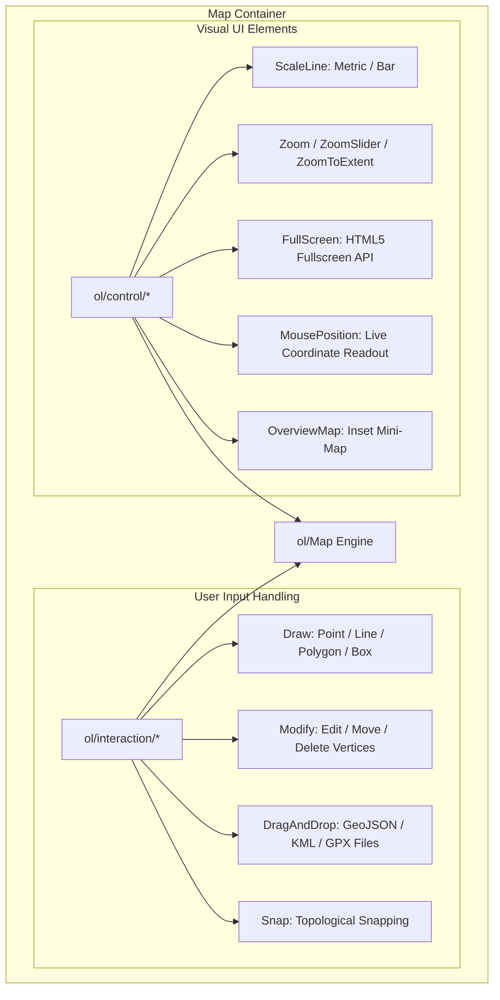

# Module 5 - Map Interactions & Controls

Welcome to Module 5! In this module, we move beyond passive map viewing and data visualization to give users full control over the map experience. You will master OpenLayers **Interactions** (digitizing vector geometries, editing vertices, and dragging & dropping external spatial files) and **Controls** (visual on-screen UI elements like scale lines, zoom sliders, coordinate readouts, and full-screen toggles).



---

## 1. Interactions vs. Controls

Before writing code, understand the architectural separation of concerns in OpenLayers:

| Concept | Base Class | Primary Purpose | Examples |
|---|---|---|---|
| **Interactions** | `ol/interaction/Interaction` | Responds to mouse, touch, pointer, and keyboard gestures to alter map navigation or mutate geometry coordinates directly. | `Draw`, `Modify`, `DragAndDrop`, `Snap`, `Translate`, `Select` |
| **Controls** | `ol/control/Control` | Fixed visual DOM elements positioned over the map viewport that provide status indicators or one-click commands. | `ScaleLine`, `Zoom`, `ZoomSlider`, `FullScreen`, `MousePosition`, `OverviewMap` |

---

## 2. Map Interactions: Digitizing & Editing Vector Data

OpenLayers provides an extensive suite of digitizing interactions that allow users to draw, edit, and manipulate spatial vector features in the browser.

### 2.1 The `Draw` Interaction (`ol/interaction/Draw`)

The `Draw` interaction captures mouse or touch clicks and converts them into OpenLayers `Feature` geometries stored in an underlying `VectorSource`.

```javascript
import Draw, { createBox } from 'ol/interaction/Draw.js';

// Instantiate drawing interaction for Polygons
const draw = new Draw({
  source: vectorSource,
  type: 'Polygon'
});

map.addInteraction(draw);
```

#### Supported Drawing Geometry Types:
- `'Point'`: Places a single coordinate feature on click.
- `'LineString'`: Draws connected line segments; double-click or enter to finish.
- `'Polygon'`: Draws a closed boundary; double-click to close and finish.
- `'Circle'`: Draws a circular geometry defined by a center coordinate and edge radius.
- `'MultiPoint'`, `'MultiLineString'`, `'MultiPolygon'`: Draws multi-part geometries.

#### Freehand Drawing
For pencil/scribble digitizing, set `freehand: true`:
```javascript
const freehandDraw = new Draw({
  source: vectorSource,
  type: 'LineString',
  freehand: true
});
```

#### Drawing Rectangles / Bounding Boxes
To draw rectangular bounding boxes, set `type: 'Circle'` and use the built-in `createBox()` geometry function:
```javascript
import Draw, { createBox } from 'ol/interaction/Draw.js';

const boxDraw = new Draw({
  source: vectorSource,
  type: 'Circle',
  geometryFunction: createBox()
});
```

#### Capturing Draw Events
Listen to `drawstart` and `drawend` lifecycle events to attach attributes or perform calculations:
```javascript
draw.on('drawstart', (event) => {
  console.log('User started drawing a geometry...');
});

draw.on('drawend', (event) => {
  const feature = event.feature;
  feature.set('createdAt', new Date().toISOString());
  console.log('Finished drawing feature:', feature.getGeometry().getType());
});
```

---

### 2.2 The `Modify` Interaction (`ol/interaction/Modify`)

The `Modify` interaction enables editing existing geometries by clicking and dragging their vertices or inserting new vertices along line segments.

```javascript
import Modify from 'ol/interaction/Modify.js';

const modify = new Modify({
  source: vectorSource
});

map.addInteraction(modify);
```

#### Key Capabilities of `Modify`:
1. **Move an Existing Vertex:** Click and drag any existing point/vertex.
2. **Insert a New Vertex:** Hovering over a line segment or polygon boundary displays a ghost midpoint. Click and drag this midpoint to insert a new vertex.
3. **Delete a Vertex:** By default, pressing `Alt` + clicking an existing vertex removes it. You can customize this shortcut using `deleteCondition`:
   ```javascript
   import { altKeyOnly } from 'ol/events/condition.js';

   const modify = new Modify({
     source: vectorSource,
     deleteCondition: altKeyOnly // Hold Alt and click a vertex to remove it
   });
   ```

#### Modify Lifecycle Events:
```javascript
modify.on('modifyend', (event) => {
  const modifiedFeatures = event.features.getArray();
  console.log(`Updated ${modifiedFeatures.length} features!`);
});
```

---

### 2.3 Topological Precision: The `Snap` Interaction (`ol/interaction/Snap`)

When digitizing adjacent parcels or connecting pipelines, human pointer movements are rarely pixel-perfect. The **`Snap` interaction** automatically snaps the cursor to existing vertices and edges within a configurable pixel radius:

```javascript
import Snap from 'ol/interaction/Snap.js';

const snap = new Snap({
  source: vectorSource,
  pixelTolerance: 12 // Snap when cursor comes within 12px of existing vertices
});

// Always add Snap AFTER Draw and Modify interactions!
map.addInteraction(snap);
```

> **Order of Interactions:** Always add `Snap` to the map **after** adding `Draw` or `Modify`. OpenLayers evaluates interactions in reverse order of addition; having `Snap` execute first ensures the cursor coordinate snaps *before* the draw or modify interaction processes the click.

---

### 2.4 The `DragAndDrop` Interaction (`ol/interaction/DragAndDrop`)

The `DragAndDrop` interaction enables users to drag spatial files directly from their operating system desktop and drop them onto the map canvas. OpenLayers automatically parses the file and instantiates vector features.

```javascript
import DragAndDrop from 'ol/interaction/DragAndDrop.js';
import GeoJSON from 'ol/format/GeoJSON.js';
import KML from 'ol/format/KML.js';
import GPX from 'ol/format/GPX.js';

const dragAndDrop = new DragAndDrop({
  formatConstructors: [
    GeoJSON,
    KML,
    GPX
  ]
});

dragAndDrop.on('addfeatures', (event) => {
  // Features are automatically reprojected to the map view projection!
  vectorSource.addFeatures(event.features);

  // Zoom view to fit dropped features
  map.getView().fit(vectorSource.getExtent(), {
    padding: [40, 40, 40, 40],
    duration: 600
  });
});

map.addInteraction(dragAndDrop);
```

#### Why `DragAndDrop` is Powerful:
- **Zero Server Overhead:** Files are parsed purely client-side in the browser using HTML5 File API and OpenLayers format parsers.
- **Automatic Reprojection:** When given the view projection, coordinates are transformed automatically into the map's current coordinate system (`EPSG:3857`).

---

## 3. Map Controls: Enhancing the User Interface

Map controls provide visual context, navigation shortcuts, and metadata overlays.

```text
Map Viewport
 ├── Top-Left:      Zoom Controls (+ / -), FullScreen, ZoomSlider
 ├── Top-Right:     OverviewMap (Mini-Map Inset)
 ├── Bottom-Left:   ScaleLine (Metric / Nautical / Imperial)
 └── Bottom-Right:  MousePosition (Coordinates), Attribution
```

### 3.1 Managing Default Controls
By default, OpenLayers automatically includes:
- `Zoom` (+ and - buttons)
- `Rotate` (bearing reset button when map is rotated)
- `Attribution` (collapsible copyright notice)

You can customize or disable default controls using `defaults()` from `ol/control/defaults.js`:

```javascript
import { defaults as defaultControls } from 'ol/control/defaults.js';
import ScaleLine from 'ol/control/ScaleLine.js';
import FullScreen from 'ol/control/FullScreen.js';

const map = new Map({
  target: 'map',
  layers: [baseLayer],
  view: new View({ /* ... */ }),
  // Extend default controls with additional controls
  controls: defaultControls({
    zoom: true,
    rotate: true,
    attribution: true
  }).extend([
    new ScaleLine(),
    new FullScreen()
  ])
});
```

---

### 3.2 The `ScaleLine` Control (`ol/control/ScaleLine`)

The `ScaleLine` control displays the real-world ground distance corresponding to screen pixels at the current zoom level and latitude.

```javascript
import ScaleLine from 'ol/control/ScaleLine.js';

const scaleLine = new ScaleLine({
  units: 'metric',        // 'metric' (m/km), 'imperial' (ft/mi), 'nautical' (nm), 'degrees'
  bar: true,              // Displays a graphical segmented bar instead of a simple line
  steps: 4,               // Number of segments in the scale bar
  text: true,             // Displays distance numbers above segments
  minWidth: 140           // Minimum pixel width of the control
});

map.addControl(scaleLine);
```

#### Customizing ScaleLine Appearance with CSS:
```css
.ol-scale-line {
  background: rgba(15, 23, 42, 0.75);
  border-radius: 6px;
  padding: 4px 8px;
  border: 1px solid rgba(255, 255, 255, 0.2);
}

.ol-scale-bar {
  border-color: #38bdf8;
}
```

---

### 3.3 Zoom Controls

#### 1. Standard `Zoom` Control (`ol/control/Zoom`)
```javascript
import Zoom from 'ol/control/Zoom.js';

const zoomControl = new Zoom({
  zoomInLabel: '+',
  zoomOutLabel: '−',
  zoomInTipLabel: 'Zoom In',
  zoomOutTipLabel: 'Zoom Out'
});
```

#### 2. `ZoomSlider` Control (`ol/control/ZoomSlider`)
The `ZoomSlider` displays an interactive draggable slider bar between the zoom buttons:
```javascript
import ZoomSlider from 'ol/control/ZoomSlider.js';

const zoomSlider = new ZoomSlider();
map.addControl(zoomSlider);
```

#### 3. `ZoomToExtent` Control (`ol/control/ZoomToExtent`)
Provides a "Home Extent" button that resets the map view to a specified bounding box:
```javascript
import ZoomToExtent from 'ol/control/ZoomToExtent.js';
import { fromLonLat } from 'ol/proj.js';

const homeExtentButton = new ZoomToExtent({
  extent: [
    ...fromLonLat([73.7, 18.4]), // [minX, minY]
    ...fromLonLat([74.0, 18.6])  // [maxX, maxY]
  ],
  label: '⌂',
  tipLabel: 'Fit to City Bounds'
});

map.addControl(homeExtentButton);
```

---

### 3.4 The `FullScreen` Control (`ol/control/FullScreen`)

The `FullScreen` control utilizes the HTML5 Fullscreen API to expand the map container to fill the entire physical display.

```javascript
import FullScreen from 'ol/control/FullScreen.js';

const fullScreenControl = new FullScreen({
  tipLabel: 'Toggle Fullscreen Mode'
});

map.addControl(fullScreenControl);
```

> **Tip:** If your map has external UI control panels outside the `#map` `<div>`, specify the common parent container as the fullscreen target using `source: 'app-container'`.

---

### 3.5 Additional Essential Controls

#### 1. `MousePosition` (`ol/control/MousePosition`)
Displays dynamic coordinates of the cursor in real time. You can format the coordinates into Longitude/Latitude degrees using `createStringXY`:

```javascript
import MousePosition from 'ol/control/MousePosition.js';
import { createStringXY } from 'ol/coordinate.js';

const mousePosition = new MousePosition({
  coordinateFormat: createStringXY(4), // 4 decimal places (e.g. 73.8567, 18.5204)
  projection: 'EPSG:4326',             // Output in WGS 84 Lon/Lat degrees
  className: 'custom-mouse-position',
  target: document.getElementById('coordinates-display'), // Render in dedicated HTML element
  undefinedHTML: 'Coordinates: Point outside map'
});

map.addControl(mousePosition);
```

#### 2. `OverviewMap` (`ol/control/OverviewMap`)
Displays an inset mini-map in the corner showing the larger geographic area and a rectangle representing the current viewport:

```javascript
import OverviewMap from 'ol/control/OverviewMap.js';
import TileLayer from 'ol/layer/Tile.js';
import OSM from 'ol/source/OSM.js';

const overviewMap = new OverviewMap({
  layers: [
    new TileLayer({
      source: new OSM()
    })
  ],
  collapsed: false, // Start expanded
  collapsible: true
});

map.addControl(overviewMap);
```

---

## 4. Building a Custom OpenLayers Control

Any standard DOM element can be turned into an OpenLayers control by subclassing or instantiating `ol/control/Control`.

```javascript
import { Control } from 'ol/control.js';
import { fromLonLat } from 'ol/proj.js';

class HomeControl extends Control {
  constructor(opt_options) {
    const options = opt_options || {};

    // 1. Create button element
    const button = document.createElement('button');
    button.innerHTML = '🎯';
    button.title = 'Reset to City Center';

    // 2. Wrap inside control div
    const element = document.createElement('div');
    element.className = 'ol-unselectable ol-control reset-center-control';
    element.appendChild(button);

    super({
      element: element,
      target: options.target
    });

    // 3. Handle click
    button.addEventListener('click', () => {
      this.getMap().getView().animate({
        center: fromLonLat([73.8567, 18.5204]),
        zoom: 14,
        duration: 800
      });
    });
  }
}

map.addControl(new HomeControl());
```

---

### Reference Resources

- **OpenLayers `Draw` Interaction API:** [https://openlayers.org/en/latest/apidoc/module-ol_interaction_Draw-Draw.html](https://openlayers.org/en/latest/apidoc/module-ol_interaction_Draw-Draw.html)
- **OpenLayers `Modify` Interaction API:** [https://openlayers.org/en/latest/apidoc/module-ol_interaction_Modify-Modify.html](https://openlayers.org/en/latest/apidoc/module-ol_interaction_Modify-Modify.html)
- **OpenLayers `DragAndDrop` API:** [https://openlayers.org/en/latest/apidoc/module-ol_interaction_DragAndDrop-DragAndDrop.html](https://openlayers.org/en/latest/apidoc/module-ol_interaction_DragAndDrop-DragAndDrop.html)
- **OpenLayers `ScaleLine` API:** [https://openlayers.org/en/latest/apidoc/module-ol_control_ScaleLine-ScaleLine.html](https://openlayers.org/en/latest/apidoc/module-ol_control_ScaleLine-ScaleLine.html)
- **OpenLayers `OverviewMap` API:** [https://openlayers.org/en/latest/apidoc/module-ol_control_OverviewMap-OverviewMap.html](https://openlayers.org/en/latest/apidoc/module-ol_control_OverviewMap-OverviewMap.html)

---

### Practical Activity

#### Objective:
Build an interactive GIS Digitizing & Map Navigation application:
1. Provide an OpenStreetMap base layer with an editable vector digitizing layer.
2. Build an on-screen toolbar to switch interaction modes:
   - **Navigate:** Pan and zoom freely.
   - **Draw Point:** Digitize point locations.
   - **Draw LineString:** Digitize routes.
   - **Draw Polygon:** Digitize land parcels.
3. Add a **DragAndDrop** interaction that accepts local `.geojson` files (test with your converted Natural Earth files like `ne_10m_populated_places.geojson` or `ne_10m_roads.geojson`), renders them on the map, and zooms to their extent.
4. Add controls: **ScaleLine** (metric bar), **FullScreen**, **ZoomSlider**, and live **MousePosition** coordinate readouts.

---

#### Complete Implementation (`index.html` & `main.js`):

##### `index.html`
```html
<!DOCTYPE html>
<html lang="en">
  <head>
    <meta charset="UTF-8" />
    <meta name="viewport" content="width=device-width, initial-scale=1.0" />
    <title>OpenLayers Digitizing & Controls</title>
    <style>
      body {
        margin: 0;
        padding: 0;
        font-family: 'Inter', system-ui, sans-serif;
        display: flex;
        flex-direction: column;
        height: 100vh;
      }
      #toolbar {
        background: #1e293b;
        color: white;
        padding: 10px 16px;
        display: flex;
        gap: 8px;
        align-items: center;
        box-shadow: 0 2px 4px rgba(0,0,0,0.1);
        z-index: 10;
      }
      #toolbar button {
        background: #334155;
        border: 1px solid #475569;
        color: white;
        padding: 6px 12px;
        border-radius: 4px;
        cursor: pointer;
        font-size: 13px;
        transition: background 0.2s;
      }
      #toolbar button:hover, #toolbar button.active {
        background: #0284c7;
        border-color: #38bdf8;
      }
      #map {
        flex: 1;
        width: 100%;
        position: relative;
      }
      #coordinates {
        position: absolute;
        bottom: 12px;
        right: 12px;
        background: rgba(15, 23, 42, 0.85);
        color: #f8fafc;
        padding: 6px 12px;
        border-radius: 4px;
        font-size: 12px;
        font-family: monospace;
        z-index: 5;
        pointer-events: none;
      }
      .reset-center-control {
        top: 95px;
        left: 0.5em;
      }
    </style>
  </head>
  <body>
    <div id="toolbar">
      <span style="font-weight: 600; margin-right: 8px;">GIS Tools:</span>
      <button id="btn-navigate" class="active">Navigate</button>
      <button id="btn-draw-point">Draw Point</button>
      <button id="btn-draw-line">Draw Line</button>
      <button id="btn-draw-polygon">Draw Polygon</button>
      <button id="btn-modify">Modify Shapes</button>
      <button id="btn-clear" style="margin-left: auto; background: #dc2626;">Clear All</button>
    </div>
    <div id="map">
      <div id="coordinates"></div>
    </div>
    <script type="module" src="./main.js"></script>
  </body>
</html>
```

##### `main.js`
```javascript
import Map from 'ol/Map.js';
import View from 'ol/View.js';
import TileLayer from 'ol/layer/Tile.js';
import VectorLayer from 'ol/layer/Vector.js';
import OSM from 'ol/source/OSM.js';
import VectorSource from 'ol/source/Vector.js';
import { fromLonLat } from 'ol/proj.js';
import { Style, Circle as CircleStyle, Fill, Stroke } from 'ol/style.js';

// Interactions
import Draw from 'ol/interaction/Draw.js';
import Modify from 'ol/interaction/Modify.js';
import Snap from 'ol/interaction/Snap.js';
import DragAndDrop from 'ol/interaction/DragAndDrop.js';
import GeoJSON from 'ol/format/GeoJSON.js';
import KML from 'ol/format/KML.js';
import GPX from 'ol/format/GPX.js';

// Controls
import { defaults as defaultControls } from 'ol/control/defaults.js';
import ScaleLine from 'ol/control/ScaleLine.js';
import FullScreen from 'ol/control/FullScreen.js';
import ZoomSlider from 'ol/control/ZoomSlider.js';
import MousePosition from 'ol/control/MousePosition.js';
import OverviewMap from 'ol/control/OverviewMap.js';
import { createStringXY } from 'ol/coordinate.js';

import 'ol/ol.css';

// 1. Vector source for digitizing
const digitizeSource = new VectorSource();

const digitizeLayer = new VectorLayer({
  source: digitizeSource,
  style: new Style({
    fill: new Fill({ color: 'rgba(56, 189, 248, 0.3)' }),
    stroke: new Stroke({ color: '#0284c7', width: 2.5 }),
    image: new CircleStyle({
      radius: 7,
      fill: new Fill({ color: '#f59e0b' }),
      stroke: new Stroke({ color: '#ffffff', width: 2 })
    })
  })
});

// 2. Base Tile Layer
const baseLayer = new TileLayer({
  source: new OSM()
});

// 3. Initialize Map with Enhanced Controls
const map = new Map({
  target: 'map',
  layers: [baseLayer, digitizeLayer],
  view: new View({
    center: fromLonLat([73.8567, 18.5204]), // Pune, India
    zoom: 13
  }),
  controls: defaultControls().extend([
    new ScaleLine({ units: 'metric', bar: true, steps: 4, text: true }),
    new FullScreen(),
    new ZoomSlider(),
    new OverviewMap({
      layers: [new TileLayer({ source: new OSM() })],
      collapsed: true
    }),
    new MousePosition({
      coordinateFormat: createStringXY(4),
      projection: 'EPSG:4326',
      target: document.getElementById('coordinates')
    })
  ])
});

// 4. Interaction State Management
let currentInteraction = null;

const modifyInteraction = new Modify({ source: digitizeSource });
const snapInteraction = new Snap({ source: digitizeSource });

// Drag and drop interaction
const dragAndDropInteraction = new DragAndDrop({
  formatConstructors: [GeoJSON, KML, GPX]
});

dragAndDropInteraction.on('addfeatures', (event) => {
  digitizeSource.addFeatures(event.features);
  map.getView().fit(digitizeSource.getExtent(), {
    padding: [40, 40, 40, 40],
    duration: 800
  });
});

map.addInteraction(dragAndDropInteraction);
map.addInteraction(snapInteraction);

function setMode(mode) {
  // Remove active drawing or modifying interactions
  if (currentInteraction) {
    map.removeInteraction(currentInteraction);
    currentInteraction = null;
  }
  map.removeInteraction(modifyInteraction);

  // Update button active states
  document.querySelectorAll('#toolbar button').forEach((btn) => btn.classList.remove('active'));

  if (mode === 'Point' || mode === 'LineString' || mode === 'Polygon') {
    currentInteraction = new Draw({
      source: digitizeSource,
      type: mode
    });
    map.addInteraction(currentInteraction);
  } else if (mode === 'Modify') {
    map.addInteraction(modifyInteraction);
  }
}

// 5. Button Listeners
document.getElementById('btn-navigate').onclick = function () {
  setMode('Navigate');
  this.classList.add('active');
};

document.getElementById('btn-draw-point').onclick = function () {
  setMode('Point');
  this.classList.add('active');
};

document.getElementById('btn-draw-line').onclick = function () {
  setMode('LineString');
  this.classList.add('active');
};

document.getElementById('btn-draw-polygon').onclick = function () {
  setMode('Polygon');
  this.classList.add('active');
};

document.getElementById('btn-modify').onclick = function () {
  setMode('Modify');
  this.classList.add('active');
};

document.getElementById('btn-clear').onclick = function () {
  if (confirm('Clear all drawn shapes?')) {
    digitizeSource.clear();
  }
};
```