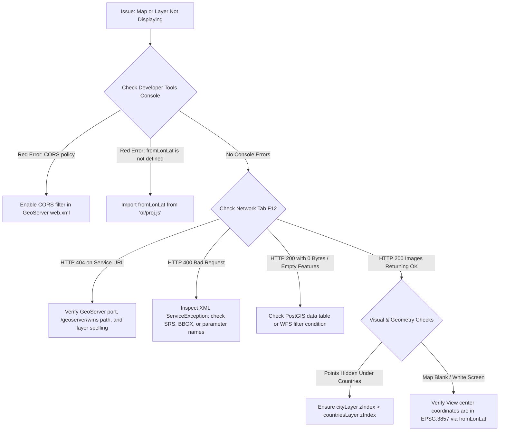

# Module 8 - Integrated Web GIS Application & Final Challenge

Welcome to the capstone module! In this session, you will integrate the concepts mastered across the entire course—OpenLayers architecture, data sources, GeoServer services, PostGIS, vector styling, map controls, and feature interactions—to build a complete, production-grade Web GIS Geoportal using the standard **Natural Earth** vector datasets.

```text
               ENTERPRISE DATA SOURCES (Natural Earth)
          ┌──────────────────┴──────────────────┐
          ↓                                     ↓
GeoServer WMS (Countries / Boundaries) GeoServer WFS (Populated Places)
(ne_10m_admin_0_countries)            (ne_10m_populated_places)
          │                                     │
          └──────────────────┬──────────────────┘
                             ↓
                OPENLAYERS CLIENT APPLICATION
     ┌───────────────────────┼───────────────────────┐
     ↓                       ↓                       ↓
Base Map (OSM)        Dynamic Styling         Select & Hover
(minZoom constraint) (Capitals / Megacities) (Info Panel & Counts)
     │                       │                       │
     └───────────────────────┼───────────────────────┘
                             ↓
                  INTEGRATED WEB GIS UI
```

---

## 1. Project Setup & Architecture

A production Web GIS client separates visual presentation, operational data layers, styling rules, and user interaction handlers into a modular hierarchy.

### 1.1 Component Hierarchy
Every interactive OpenLayers application is structured around a tree of coordinated objects:

```text
HTML Container (#map)
         ↓
OpenLayers Map Instance
 ├── View (EPSG:3857, center, zoom, minZoom, maxZoom)
 ├── Controls (Zoom, Attribution, ScaleLine, FullScreen)
 ├── Overlays (Popup container anchored to coordinates)
 ├── Interactions (Select on click, Hover pointermove)
 └── Layers (Ordered by zIndex)
      ├── Base Layer: OpenStreetMap (TileLayer + OSM, zIndex: 0)
      ├── Operational Layer: Countries (ImageLayer + ImageWMS: ne_10m_admin_0_countries, zIndex: 1)
      └── Vector Layer: Populated Places (VectorLayer + VectorSource: ne_10m_populated_places, zIndex: 2)
```

### 1.2 Managing Layer Stacking (`zIndex`)

In multi-layer applications, layer visibility conflicts occur when rasters hide vector points. Explicitly setting `zIndex` ensures deterministic rendering:

- `zIndex: 0` $\rightarrow$ Base map (OSM / Satellite).
- `zIndex: 1` $\rightarrow$ Polygon boundary overlays (WMS / Natural Earth Countries).
- `zIndex: 2` $\rightarrow$ Interactive vector points & cities (WFS / Natural Earth Populated Places).

---

## 2. Base Map & View Setup

The map view governs geographic perspective, initial bounds, and navigation constraints.

```javascript
import Map from 'ol/Map.js';
import View from 'ol/View.js';
import TileLayer from 'ol/layer/Tile.js';
import OSM from 'ol/source/OSM.js';
import { fromLonLat } from 'ol/proj.js';

// 1. Base Layer
const baseLayer = new TileLayer({
  source: new OSM(),
  zIndex: 0
});

// 2. View Configuration with Navigation Constraints
const view = new View({
  center: fromLonLat([0, 20]), // Centered over global view
  zoom: 3,
  minZoom: 2,  // Prevents over-zooming out into void
  maxZoom: 18  // Prevents over-zooming beyond tile availability
});

const map = new Map({
  target: 'map',
  layers: [baseLayer],
  view: view
});
```

---

## 3. GeoServer WMS Layer Integration

The boundary layer represents country borders rendered as a server-side WMS map image from Natural Earth (`ne_10m_admin_0_countries`):

```javascript
import ImageLayer from 'ol/layer/Image.js';
import ImageWMS from 'ol/source/ImageWMS.js';

const countriesSource = new ImageWMS({
  url: 'http://localhost:8080/geoserver/wms', // Fallback: 'https://demo.geoserver.org/geoserver/wms'
  params: {
    'LAYERS': 'training:ne_10m_admin_0_countries',
    'TRANSPARENT': true,
    'FORMAT': 'image/png'
  },
  serverType: 'geoserver'
});

const countriesLayer = new ImageLayer({
  source: countriesSource,
  opacity: 0.65,
  zIndex: 1 // Sits above OSM base map, below city markers
});

map.addLayer(countriesLayer);
```

### Key Considerations:

- **`TRANSPARENT: true`:** Mandatory so lower base map street labels show through country boundaries.
- **Inspect Network Traffic:** Open browser Developer Tools (`F12` $\rightarrow$ **Network**). Pan the map to verify outgoing `GetMap` requests with updated `BBOX` coordinates.

---

## 4. GeoServer WFS & Data-Driven Styling

The cities layer is streamed as client-side vector geometries via WFS (or local GeoJSON), enabling dynamic styling based on Natural Earth attributes (`FEATURECLA` and `POP_MAX`):

```javascript
import VectorLayer from 'ol/layer/Vector.js';
import VectorSource from 'ol/source/Vector.js';
import GeoJSON from 'ol/format/GeoJSON.js';
import { Style, Circle as CircleStyle, Fill, Stroke, Text } from 'ol/style.js';

// 1. Pre-cached Styles for High Performance
const capitalStyle = new Style({
  image: new CircleStyle({
    radius: 8,
    fill: new Fill({ color: '#D97706' }), // Amber/Gold for National Capitals
    stroke: new Stroke({ color: '#FFFFFF', width: 2 })
  })
});

const standardCityStyle = new Style({
  image: new CircleStyle({
    radius: 5,
    fill: new Fill({ color: '#2563EB' }), // Blue for other cities
    stroke: new Stroke({ color: '#FFFFFF', width: 1.5 })
  })
});

// 2. Attribute-Based Style Function
function cityStyleFunction(feature, resolution) {
  const featureClass = feature.get('FEATURECLA') || feature.get('featurecla');
  const isCapital = featureClass === 'Admin-0 capital';
  const baseStyle = isCapital ? capitalStyle : standardCityStyle;

  // Add text label when zoomed in close (resolution < 5000 meters/pixel)
  if (resolution < 5000) {
    const cityName = feature.get('NAME') || feature.get('name') || '';
    return new Style({
      image: baseStyle.getImage(),
      text: new Text({
        text: cityName,
        font: 'bold 12px Inter, sans-serif',
        fill: new Fill({ color: '#0F172A' }),
        stroke: new Stroke({ color: '#FFFFFF', width: 3 }),
        offsetY: -14
      })
    });
  }

  return baseStyle;
}

// 3. WFS Vector Layer (or local ne_10m_populated_places.geojson)
const citySource = new VectorSource({
  format: new GeoJSON(),
  url: 'http://localhost:8080/geoserver/wfs?service=WFS&version=2.0.0&request=GetFeature&typeNames=training:ne_10m_populated_places&outputFormat=application/json'
});

const cityLayer = new VectorLayer({
  source: citySource,
  style: cityStyleFunction,
  zIndex: 2 // Rendered on top of country boundaries
});

map.addLayer(cityLayer);
```

---

## 5. Feature Interaction & Attribute Display

Users expect instant feedback when clicking features. You can present attributes through an **external info panel** or a coordinate-anchored **`ol/Overlay` popup**.

```javascript
import Select from 'ol/interaction/Select.js';
import { click } from 'ol/events/condition.js';

// 1. Configure Selection Interaction with Hit Tolerance
const selectInteraction = new Select({
  condition: click,
  layers: [cityLayer],
  hitTolerance: 5, // Pixel buffer around touch/click for mobile friendliness
  style: new Style({
    image: new CircleStyle({
      radius: 11,
      fill: new Fill({ color: '#E11D48' }), // Highlight Crimson
      stroke: new Stroke({ color: '#FFFFFF', width: 2.5 })
    })
  })
});
map.addInteraction(selectInteraction);

// 2. Output Properties to External HTML Info Panel
const infoPanel = document.getElementById('feature-details');

selectInteraction.on('select', (event) => {
  const selected = event.selected;

  if (selected.length > 0) {
    const props = selected[0].getProperties();
    const pop = props.POP_MAX ? Number(props.POP_MAX).toLocaleString() : 'N/A';
    infoPanel.innerHTML = `
      <h3>${props.NAME || 'City'}</h3>
      <p><strong>Country:</strong> ${props.ADM0NAME || 'N/A'}</p>
      <p><strong>Classification:</strong> ${props.FEATURECLA || 'N/A'}</p>
      <p><strong>Population:</strong> ${pop}</p>
    `;
  } else {
    infoPanel.innerHTML = '<p class="placeholder">Click any city on the map to inspect details.</p>';
  }
});
```

---

## 6. Controls & Map UI Polishing

OpenLayers ships with essential map controls that improve user orientation and usability.

```javascript
import ScaleLine from 'ol/control/ScaleLine.js';
import FullScreen from 'ol/control/FullScreen.js';
import ZoomSlider from 'ol/control/ZoomSlider.js';
import MousePosition from 'ol/control/MousePosition.js';
import { createStringXY } from 'ol/coordinate.js';

// Add ScaleLine, FullScreen, ZoomSlider, and MousePosition
map.addControl(new ScaleLine({ units: 'metric', bar: true, steps: 4, text: true }));
map.addControl(new FullScreen());
map.addControl(new ZoomSlider());
map.addControl(new MousePosition({
  coordinateFormat: createStringXY(4),
  projection: 'EPSG:4326',
  target: document.getElementById('mouse-coords')
}));
```

---

## 7. Systematic Troubleshooting & Debugging

When building multi-tier GIS applications, use this diagnostic checklist before requesting assistance:



### Top 5 Common Pitfalls:

- **Coordinate Misprojection:** Passing raw latitude/longitude degrees `[73.85, 18.52]` directly to `new View({ center: ... })` without calling `fromLonLat([73.85, 18.52])`. The map centers in the Atlantic Ocean off the coast of Africa.
- **Missing `ol.css`:** Forgetting `import 'ol/ol.css';` causes map controls, zoom buttons, and attribution text to appear as broken, stacked text in the corner of the screen.
- **CORS Violations:** Browsers blocking WFS GeoJSON requests from `http://localhost:5173` to `http://localhost:8080` because GeoServer CORS filter is commented out.
- **Z-Index Inversion:** Adding `cityLayer` before `countriesLayer` without explicit `zIndex` values, causing the opaque country polygons to cover the city points.
- **WFS Version Parameter:** WFS 2.0 uses `typeNames` and `count`, whereas WFS 1.1 uses `typeName` and `maxFeatures`. Mixing these parameters can return empty XML.

---

### Reference resources

- **OpenLayers Core API Reference:** [https://openlayers.org/en/latest/apidoc/](https://openlayers.org/en/latest/apidoc/)
- **Natural Earth Datasets:** [https://www.naturalearthdata.com/downloads/](https://www.naturalearthdata.com/downloads/)
- **GeoServer Web Map Service (WMS) Reference:** [https://docs.geoserver.org/latest/en/user/services/wms/](https://docs.geoserver.org/latest/en/user/services/wms/)
- **GeoServer Web Feature Service (WFS) Reference:** [https://docs.geoserver.org/latest/en/user/services/wfs/](https://docs.geoserver.org/latest/en/user/services/wfs/)
- **MDN Web Docs — Developer Tools Network Tab:** [https://developer.mozilla.org/en-US/docs/Learn_web_development/Howto/Solve_HTML_problems/Cross_network_debugging](https://developer.mozilla.org/en-US/docs/Learn_web_development/Howto/Solve_HTML_problems/Cross_network_debugging)

---

### Practical activity

#### Core Challenge
Build the application independently using the requirements below. You may refer to the OpenLayers API documentation and your previous module examples. Use Developer Tools to troubleshoot issues before asking for help.

1. **Base Map & Constraints:**
   - Initialize an OpenLayers map in `#map`.
   - Set the `View` projection to `EPSG:3857`.
   - Center the map globally using `fromLonLat([0, 20])`.
   - Enforce navigation limits using `minZoom: 2` and `maxZoom: 18`.
   - Add an OpenStreetMap `TileLayer` as the base layer (`zIndex: 0`).

2. **GeoServer WMS Countries Layer:**
   - Add an `ImageLayer` powered by `ImageWMS` connecting to GeoServer (`http://localhost:8080/geoserver/wms`).
   - Request the `training:ne_10m_admin_0_countries` layer with `TRANSPARENT: true`.
   - Set `zIndex: 1` so country boundaries sit above OSM but below city points.

3. **GeoServer WFS Populated Places Layer & Dynamic Styling:**
   - Add a `VectorLayer` consuming `training:ne_10m_populated_places` via WFS as GeoJSON.
   - Implement a dynamic style function:
     - If `FEATURECLA === 'Admin-0 capital'`: Render a **Gold/Amber** marker (radius: 8).
     - Otherwise: Render a **Blue** marker (radius: 5).
   - Set `zIndex: 2`.

4. **Interactive Feature Selection:**
   - Add a `Select` interaction configured to trigger on `click`.
   - When a city is selected, extract its properties (`NAME`, `ADM0NAME`, `POP_MAX`, `FEATURECLA`) and render them inside an HTML info panel outside the map.

5. **Map Controls:**
   - Add a visible `ScaleLine` control with metric units.
   - Add a `FullScreen` control button.
   - Add a `ZoomSlider` control.

---

#### Extension Challenge
Once the core application is working, choose any **two** extension tasks below and implement them:

- **Option A — Interactive Hover Effect:** Add a `pointermove` listener that changes the browser cursor to `'pointer'` and applies a cyan highlight stroke when hovering over a city.
- **Option B — Coordinate Popup Overlay:** Replace the external info panel with an `ol/Overlay` popup card anchored directly over the clicked city's coordinates.
- **Option C — Dynamic Megacities Filter:** Add an HTML `<button>` that dynamically applies a `CQL_FILTER` (`POP_MAX >= 5000000`) to the layer without reloading the page.
- **Option D — Layer Visibility Switcher:** Add UI checkboxes that toggle the visibility of the Countries and Cities layers independently (`layer.setVisible()`).
- **Option E — Live Feature Counter:** Display a badge in the UI header showing the total number of cities loaded in the `VectorSource`.

---

#### Complete Implementation (`main.js` and `index.html`):

##### HTML Layout (`index.html`):
```html
<!DOCTYPE html>
<html lang="en">
<head>
  <meta charset="UTF-8">
  <title>Global Cities & Nations Geoportal</title>
  <link rel="stylesheet" href="./style.css">
  <style>
    body {
      margin: 0;
      font-family: 'Inter', system-ui, sans-serif;
      display: flex;
      flex-direction: column;
      height: 100vh;
    }
    .app-header {
      background: #0f172a;
      color: white;
      padding: 12px 20px;
      display: flex;
      justify-content: space-between;
      align-items: center;
    }
    .main-container {
      display: flex;
      flex: 1;
      position: relative;
    }
    #map {
      flex: 1;
      height: 100%;
    }
    .sidebar {
      width: 320px;
      background: #f8fafc;
      border-left: 1px solid #e2e8f0;
      padding: 16px;
      box-sizing: border-box;
    }
    .badge {
      background: #0284c7;
      color: white;
      padding: 4px 10px;
      border-radius: 999px;
      font-size: 12px;
      font-weight: 600;
    }
    .legend-item {
      display: flex;
      align-items: center;
      gap: 8px;
      margin-top: 8px;
      font-size: 13px;
    }
    .dot {
      width: 12px;
      height: 12px;
      border-radius: 50%;
      display: inline-block;
    }
    .dot.gold { background: #d97706; }
    .dot.blue { background: #2563eb; }
  </style>
</head>
<body>
  <header class="app-header">
    <h1 style="margin: 0; font-size: 18px;">Global Cities & Nations Geoportal</h1>
    <div id="feature-counter" class="badge">Loading features...</div>
  </header>

  <div class="main-container">
    <div id="map"></div>
    
    <aside class="sidebar">
      <h2 style="font-size: 16px; margin-top: 0;">City Details</h2>
      <div id="feature-details">
        <p class="placeholder" style="color: #64748b; font-size: 13px;">Click any city marker on the map to inspect details.</p>
      </div>

      <div class="legend" style="margin-top: 24px; border-top: 1px solid #e2e8f0; padding-top: 16px;">
        <h3 style="font-size: 14px; margin-top: 0;">Symbology</h3>
        <div class="legend-item"><span class="dot gold"></span> National Capital (Admin-0)</div>
        <div class="legend-item"><span class="dot blue"></span> Standard Populated Place</div>
      </div>
    </aside>
  </div>

  <script type="module" src="./main.js"></script>
</body>
</html>
```

##### Application Logic (`main.js`):
```javascript
import Map from 'ol/Map.js';
import View from 'ol/View.js';
import TileLayer from 'ol/layer/Tile.js';
import ImageLayer from 'ol/layer/Image.js';
import VectorLayer from 'ol/layer/Vector.js';
import OSM from 'ol/source/OSM.js';
import ImageWMS from 'ol/source/ImageWMS.js';
import VectorSource from 'ol/source/Vector.js';
import GeoJSON from 'ol/format/GeoJSON.js';
import Select from 'ol/interaction/Select.js';
import ScaleLine from 'ol/control/ScaleLine.js';
import FullScreen from 'ol/control/FullScreen.js';
import ZoomSlider from 'ol/control/ZoomSlider.js';
import { click } from 'ol/events/condition.js';
import { Style, Circle as CircleStyle, Fill, Stroke, Text } from 'ol/style.js';
import { fromLonLat } from 'ol/proj.js';
import 'ol/ol.css';

// 1. Base Layer (OSM)
const baseLayer = new TileLayer({
  source: new OSM(),
  zIndex: 0
});

// 2. Operational WMS Layer: Natural Earth Countries
const countriesLayer = new ImageLayer({
  source: new ImageWMS({
    url: 'http://localhost:8080/geoserver/wms',
    params: {
      'LAYERS': 'training:ne_10m_admin_0_countries',
      'TRANSPARENT': true,
      'FORMAT': 'image/png'
    },
    serverType: 'geoserver'
  }),
  opacity: 0.65,
  zIndex: 1
});

// 3. Dynamic Styles for Populated Places
const capitalStyle = new Style({
  image: new CircleStyle({
    radius: 8,
    fill: new Fill({ color: '#D97706' }),
    stroke: new Stroke({ color: '#FFFFFF', width: 2 })
  })
});

const standardCityStyle = new Style({
  image: new CircleStyle({
    radius: 5,
    fill: new Fill({ color: '#2563EB' }),
    stroke: new Stroke({ color: '#FFFFFF', width: 1.5 })
  })
});

function cityStyleFunction(feature, resolution) {
  const featureClass = feature.get('FEATURECLA') || feature.get('featurecla');
  const base = featureClass === 'Admin-0 capital' ? capitalStyle : standardCityStyle;

  if (resolution < 5000) {
    return new Style({
      image: base.getImage(),
      text: new Text({
        text: feature.get('NAME') || feature.get('name') || '',
        font: 'bold 12px Inter, sans-serif',
        fill: new Fill({ color: '#0F172A' }),
        stroke: new Stroke({ color: '#FFFFFF', width: 3 }),
        offsetY: -14
      })
    });
  }

  return base;
}

// 4. Vector Layer: Populated Places (via WFS or local GeoJSON)
const citySource = new VectorSource({
  format: new GeoJSON(),
  url: 'http://localhost:8080/geoserver/wfs?service=WFS&version=2.0.0&request=GetFeature&typeNames=training:ne_10m_populated_places&outputFormat=application/json'
});

const cityLayer = new VectorLayer({
  source: citySource,
  style: cityStyleFunction,
  zIndex: 2
});

// Update feature counter when features load
citySource.on('featuresloadend', () => {
  const count = citySource.getFeatures().length;
  const counterEl = document.getElementById('feature-counter');
  if (counterEl) {
    counterEl.textContent = `${count} cities loaded`;
  }
});

// 5. Map Initialization
const map = new Map({
  target: 'map',
  layers: [baseLayer, countriesLayer, cityLayer],
  view: new View({
    center: fromLonLat([0, 20]),
    zoom: 3,
    minZoom: 2,
    maxZoom: 18
  })
});

// 6. Map Controls
map.addControl(new ScaleLine({ units: 'metric', bar: true, steps: 4, text: true }));
map.addControl(new FullScreen());
map.addControl(new ZoomSlider());

// 7. Interactive Feature Selection
const select = new Select({
  condition: click,
  layers: [cityLayer],
  hitTolerance: 5,
  style: new Style({
    image: new CircleStyle({
      radius: 11,
      fill: new Fill({ color: '#E11D48' }),
      stroke: new Stroke({ color: '#FFFFFF', width: 2.5 })
    })
  })
});
map.addInteraction(select);

const infoPanel = document.getElementById('feature-details');
select.on('select', (event) => {
  if (event.selected.length > 0) {
    const props = event.selected[0].getProperties();
    const pop = props.POP_MAX ? Number(props.POP_MAX).toLocaleString() : 'N/A';
    infoPanel.innerHTML = `
      <h3 style="margin-top:0; color:#0f172a;">${props.NAME || 'City'}</h3>
      <p style="margin: 4px 0;"><strong>Country:</strong> ${props.ADM0NAME || 'N/A'}</p>
      <p style="margin: 4px 0;"><strong>Classification:</strong> ${props.FEATURECLA || 'N/A'}</p>
      <p style="margin: 4px 0;"><strong>Population:</strong> ${pop}</p>
    `;
  } else {
    infoPanel.innerHTML = '<p class="placeholder" style="color: #64748b; font-size: 13px;">Click any city marker on the map to inspect details.</p>';
  }
});

// 8. Hover Pointer Feedback
map.on('pointermove', (evt) => {
  if (evt.dragging) return;
  const hit = map.hasFeatureAtPixel(evt.pixel, {
    layerFilter: (candidate) => candidate === cityLayer,
    hitTolerance: 3
  });
  map.getTargetElement().style.cursor = hit ? 'pointer' : '';
});
```